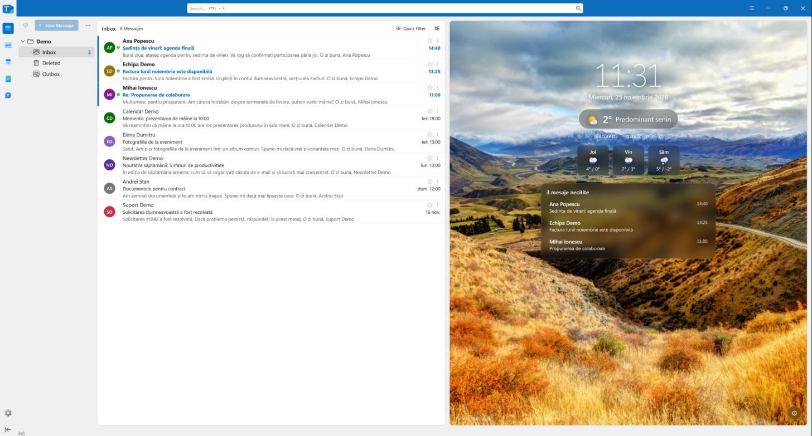

# Thunderbird în stil Outlook 365

Temă pentru **Thunderbird 161** pe Windows 11 care aduce aspectul **New Outlook / Microsoft 365**:
variantele Light și Dark, lista de mesaje cu avatare, pagina de start și bara de formatare. Totul e într-o singură extensie: se instalează dintr-un fișier, fără copiat foldere.

| Light | Dark |
|---|---|
|  |  |
|  |  |

Capturile sunt făcute într-un profil demo, cu mesaje inventate (`example.com`).

 Logo-ul din colțul din stânga sus și iconița ferestrelor (doar pentru uz personal: pasărea pornește de la logo-ul Thunderbird).

## Ce conține

| Fișier | Rol |
|---|---|
| `tema-outlook.xpi` | tema gata de instalat (un singur fișier) |
| `extensie/` | sursa: `implementation.js` (Experiment API), pagina de start (`home/`) și tema (`tema/`) |
| `extensie/tema/tema.css` | punctul de intrare al temei: Light, Dark peste el când e pornit, apoi geometria |
| `extensie/tema/userChrome*.css` | geometria (`userChrome.css`) și paletele de culori (`-light`, `-dark`) |
| `extensie/tema/userContent.css` | corpul mesajelor, Agenda și Setările |
| `extensie/tema/Icons/` | iconițe Fluent din [FluentBird](https://github.com/Deathbyteacup/fluentbird) (MIT, iconițe Microsoft Fluent UI) și logo-ul |
| `iconita-windows.cmd` | opțional: logo-ul pe scurtăturile Windows (cere o dată acceptul de administrator) |
| `README.txt` | instrucțiunile complete, în detaliu |

## Ce face

- **Interfața**: bara de sus albastră, iconițele colorate ale aplicațiilor în bara din stânga, iconițe de foldere monocrome, panouri rotunjite, accent albastru Microsoft, foldere și fonturi la mărimile din Outlook (măsurate pe ecran).
- **Lista de mesaje** (extensia): avatar cu inițiale, numele expeditorului, subiectul cu dată scurtă în format de 24 de ore, primul rând din mesaj. Butoane la hover pentru citit/necitit, arhivează și șterge.
- **Panoul de citire**: mesajul ca o foaie separată (subiectul pe fundalul ferestrei, antetul și conținutul pe o pagină cu colțuri rotunjite), avatarul lângă expeditor, butoane plate, buton „✕ Închide”.
- **Teme Light și Dark** schimbate pe loc din comutatorul lună/soare din antetul mesajului, în toată aplicația (și corpul mesajelor).
- **Aranjare**: lista, pagina de start și mesajul sunt carduri cu umbră difuză și spații egale de 12px; mesajul începe la aceeași înălțime cu primul rând din listă.
- **Logo** în colțul din stânga sus (pasărea Thunderbird care îmbrățișează pătratul cu T), același logo ca iconiță a ferestrelor (extensia) și pe scurtăturile Windows, cu `iconita-windows.cmd` (cere o dată acceptul de administrator).
- **Fereastra de scriere**: câmpurile în culorile temei și bara de formatare după modelul Brainly Text Area din Figma, cu mărimea fontului ca număr („− 13 +”, extensia).
- **Pagina de start** (extensia): ora, data, vremea și prognoza pe 3 zile (Open-Meteo), ultimele mesaje cu steluță din Inbox, fundal din Wallhaven (fără cont), Unsplash (cu cheia ta) sau ilustrația Thunderbird.

## Instalare pe scurt

1. În Thunderbird: **Add-ons and Themes** → rotița → **Install Add-on From File** → `tema-outlook.xpi` (sau trage fișierul peste fereastra Add-ons).
2. Tema se aplică după instalare (dacă nu, repornește Thunderbird). Dezinstalarea din Add-ons readuce aspectul Thunderbird.
3. Opțional, logo-ul pe scurtăturile Windows și în taskbar: dublu clic pe `iconita-windows.cmd`.

Dacă ai folosit versiunea veche (fișierele în `chrome\` din profil), șterge din `chrome\` fișierele `userChrome*.css`, `userContent.css` și folderul `Icons`, ca să nu se încarce tema de două ori.

Tema se schimbă pe loc din comutatorul lună/soare din antetul mesajului (Light/Dark în toată aplicația, fără repornire). Detaliile, selectorii verificați și ce nu se poate face sunt în `README.txt`.

## Confidențialitate

Previzualizarea mesajelor se citește local, din copia offline, fără cereri în rețea, și stă doar în memorie. Pagina de start face cereri doar către Open-Meteo (coordonatele orașului) și, dacă le alegi, către Wallhaven sau Unsplash (tema fotografiilor).

## Credite

Iconițele din `extensie/tema/Icons/` provin din [FluentBird](https://github.com/Deathbyteacup/fluentbird) de Danny King (MIT) și sunt iconițele Fluent UI de la Microsoft (MIT). Licența e în `extensie/tema/Icons/LICENSE.txt`.
